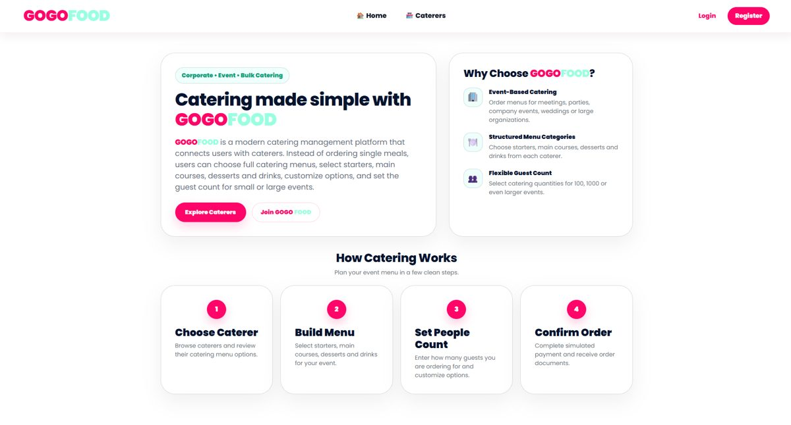
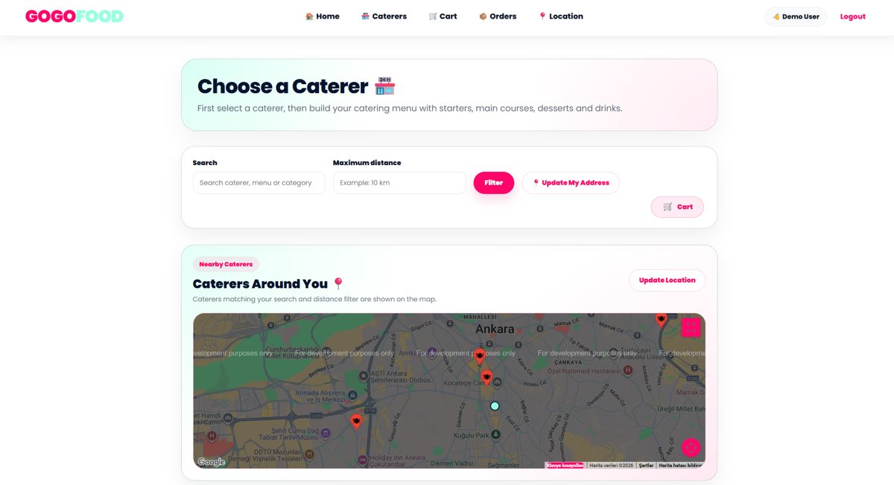
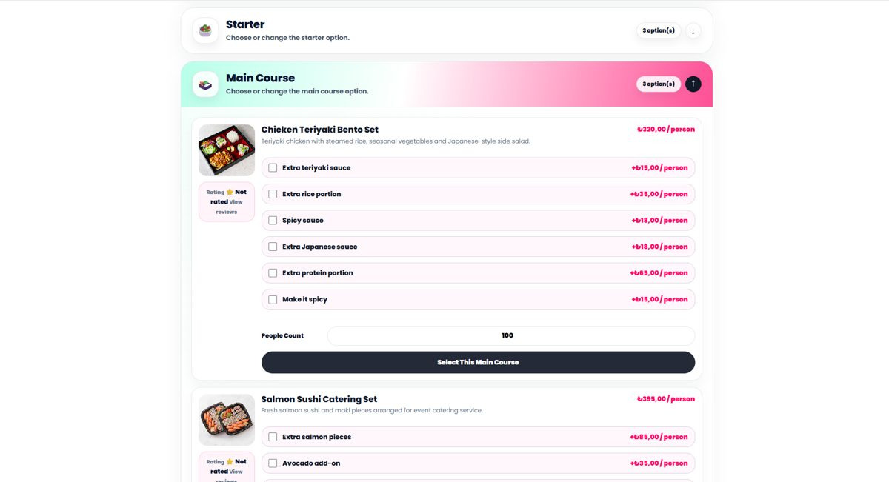
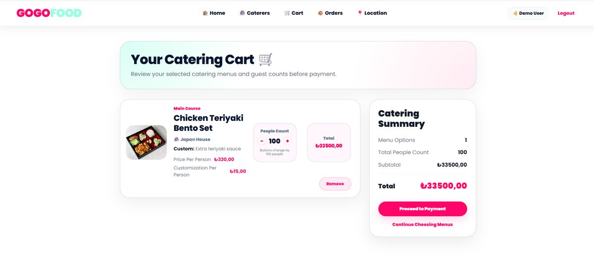
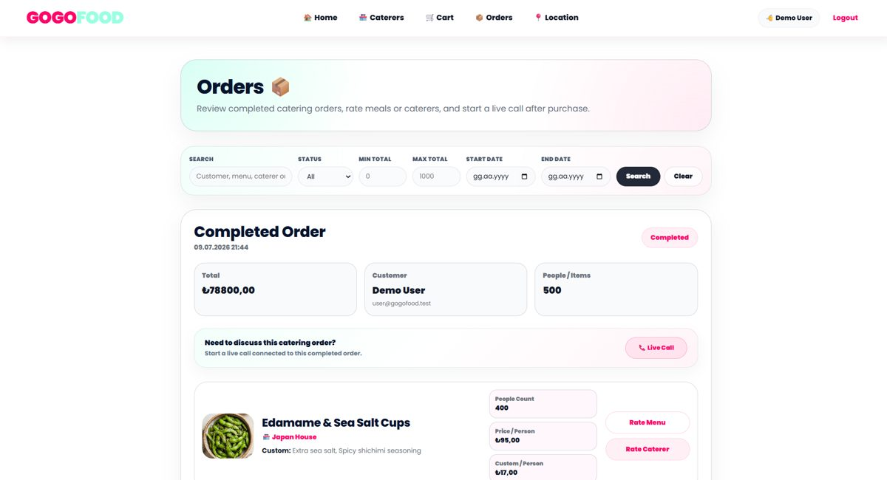
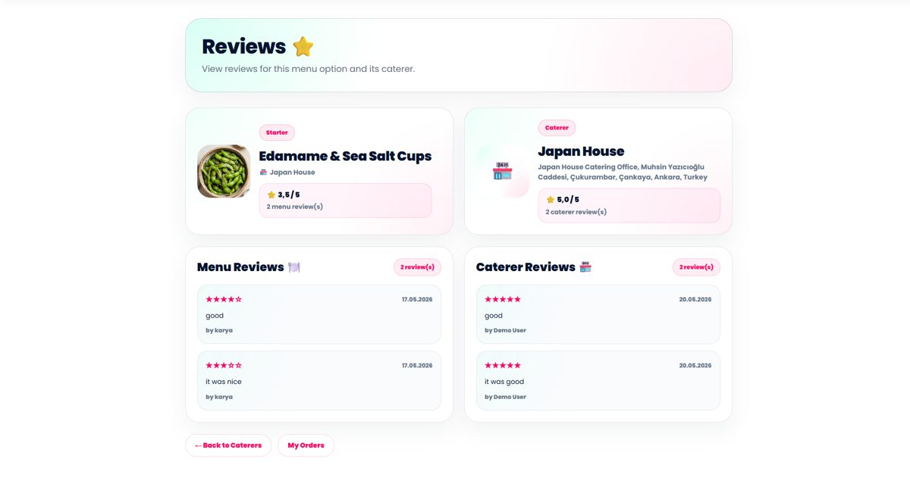
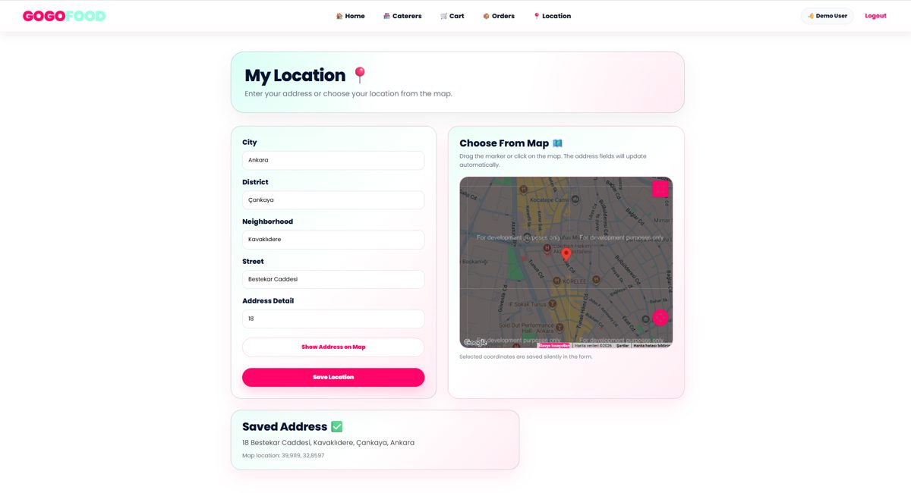

# GOGOFOOD

GOGOFOOD is a catering ordering platform built with ASP.NET Core MVC as a university course project (Çankaya University, CENG 382 Web Programming). Instead of ordering a single dish, users choose a caterer, build a full event menu (starters, main courses, desserts and drinks), set the number of guests and place the order.



## Features

**For customers**
- Browse caterers on a list and on a map, filter by search text and maximum distance (Google Maps)
- Build a menu step by step by category, with customization options priced per person
- Set the guest count, review the cart and check out with a simulated payment (no real payment is processed)
- Receive a receipt and an agreement as PDF files by email
- View order history with filters, rate menu items and caterers, and read reviews
- Save and update the delivery address on a map

**For caterers (role: Caretaker)**
- Manage menu items (with image upload) and customization options
- Own profile page

**For administrators**
- Manage users and caterers (soft delete)
- Search and browse the system log

**Account security**
- Registration, login and password reset by email
- Passwords hashed with ASP.NET Core `PasswordHasher`
- Email verification code (two-factor step) at login, valid for 5 minutes
- Anti-forgery tokens on the account forms

| Choose a caterer | Build a menu |
|---|---|
|  |  |

| Cart | Orders |
|---|---|
|  |  |

| Reviews | My location |
|---|---|
|  |  |

## Tech stack

- C# and ASP.NET Core MVC (.NET 10)
- Entity Framework Core with SQL Server (code-first migrations)
- Razor views, HTML, CSS, JavaScript
- Google Maps (location, distance filter)
- SMTP email (verification codes, receipts)
- QuestPDF (receipt and agreement PDFs)

## Getting started

Requirements: .NET 10 SDK, SQL Server (or SQL Server Express) and, optionally, a Google Maps API key and an SMTP account.

1. Clone the repository.
2. Set the connection string `DefaultConnection` in `appsettings.json` to your own SQL Server instance.
3. Create the database with `dotnet ef database update` (or run `database_script.sql`).
4. Provide the secrets as environment variables or user secrets, never in the repository:
   - `GoogleMaps__ApiKey`
   - `EmailSettings__SenderEmail`, `EmailSettings__Username`, `EmailSettings__Password`
5. Run `dotnet run`. Demo accounts and sample caterers are seeded on first start (see `Data/Data/DbInitializer.cs`).

Login uses an emailed verification code, so the email settings are needed to sign in.

## Project structure

```
Controllers/   Account, Admin, Caretaker, Cart, MenuItem, CustomizationOption, Order, Payment, Rating, User
Models/        User, Caretaker, MenuItem, CustomizationOption, CartItem, Order, OrderItem, ratings, SystemLog
Services/      EmailService, GoogleMapsService, LogService
Views/         Razor views for every controller
Data/          DbContext and seed data
Migrations/    EF Core migrations
```

## Notes and known limitations

- This is a course project and the payment page is a simulation. Card details are validated for format only and must not be stored.
- A security review is documented in [`Security_Findings.txt`](Security_Findings.txt). It lists points such as server-side price recalculation, file upload validation and replacing session-based roles with ASP.NET Core Identity. Treat the application as a learning project, not as production software.
- Parts of the code were developed with the help of an AI assistant. The conversations are listed in [`references.txt`](references.txt).
- `index.html`, `style.css`, `javascript.js` and the two image files belong to early lab exercises (Color Palette Generator, Landing Page Demo, Portfolio Website) and are not part of the application.

## Author

Karya Altundal, Computer Engineering student at Çankaya University.
